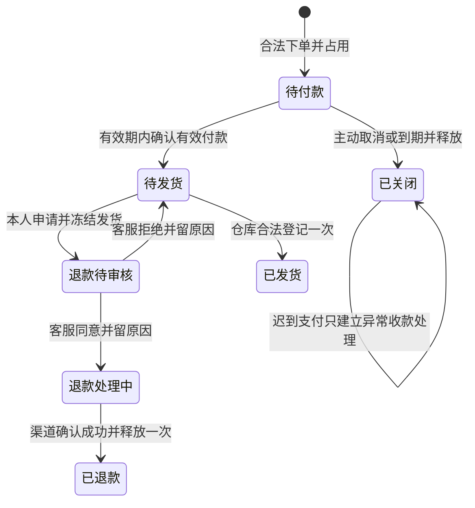
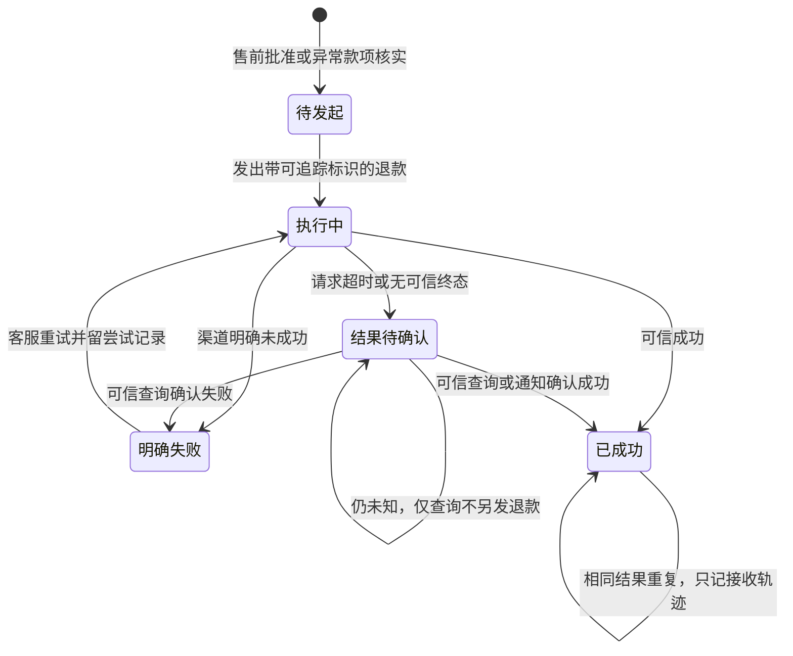

# 第 1 题业务流程与状态说明

版本：需求草案 0.1；日期：2026-11-11（北京时间）。与[需求说明](01-需求说明.md)、[假设清单](03-假设与确认清单.md)共同使用；A 项所对应行为仍是待审建议。

## 1. 五组完整业务场景

### F01：正常成交与运营核查

运营上架商品 A，售价 10000 分，可售 5 件 → 买家 A 购买 2 件 → 服务端保存订单金额 20000 分及商品快照，占用 2 件，可售变 3 → 买家在模拟支付页付款 → 商城收到并校验有效通知，记录一次收款，订单转待发货 → 仓库填承运方和运单号完成登记，2 件占用转为已出库 → 买家查运单 → 运营核对收款 20000 分、退款 0、可售 3、占用 0、出库 2。

“用户付款页返回成功”只是付款过程信息；订单进入待发货必须有服务端认可的付款事实。发货不会再扣一次可售库存。

### F02：有限库存争抢、弃单与再次购买

独立演示数据重置为可售 5 → 20 个并发、不同请求编号的合法下单请求，每单 1 件（可由 3 个预置买家发起）→ 没有取消/释放穿插时恰好 5 个建单成功，其余明确返回库存不足 → 对成功订单主动取消部分或推进至到期 → 释放对应占用且每单一次 → 其他买家用新的请求编号下单，消耗释放数量。

20 请求是业务竞争规模，不要求增加 20 个账号。同一下单请求编号重试不是一个新的购买意图；必须与 20 个独立请求分开演示。完整演示期间，模拟数据重置只能是清晰标明的测试准备操作，不是用户修复业务异常的入口。

### F03：售前退款失败、重试与成功

买家 A 下单付款 1 件 → 买家申请退款 → 申请受理时立即冻结发货 → 仓库即使用旧页面也不能发货 → 客服批准并写原因 → 模拟渠道明确退款失败 → 系统展示失败、钱仍未退、货仍占用且不能发货 → 客服重试 → 渠道确认成功 → 记录一次有效退款，订单变已退款，可售增加 1 → 买家查退款结果，运营核对收款与退款及库存。

审核拒绝分支：客服拒绝并写原因 → 保留本次申请和理由 → 恢复待发货 → 若仍未发货，买家可发起新申请，重新冻结并重新审核。审核期间重复点击不创建多个活动申请。

退款未知分支：请求超时但不知道渠道是否执行 → 退款结果待确认，保留原退款标识 → 客服查询或等待可信通知；确认成功则按成功结算，明确失败才允许重试，仍未知就继续待确认。整个未知期间均不发货、不释放库存、不另发一笔退款。

### F04：超时关闭后的迟到收款

买家 B 下单 1 件，占货 → 超过有效期仍无有效支付，关闭并释放 1 件 → 该件可由其他买家购买 → 原支付成功通知此后到达，鉴权及金额匹配 → 记录可信迟到收款及异常待办，旧订单继续已关闭，库存不变 → 客服核实交易并发起退款 → 失败可跟进，未知先查询 → 渠道确认退款成功 → 标记异常已处理并保留全程记录，库存仍不变。

例：开始可售 5，旧单占用后 4，关闭后 5；后来另一单买 1 件后可售 4。旧单迟到支付及其退款不改变这个 4，不能退完变成 5 或 6。

### F05：竞争、幂等、越权与收尾

已付款待发货订单上，同时发起退款申请与仓库发货 → 服务端按唯一生效顺序裁决 → 若申请先成功则发货拒绝；若发货先成功则申请拒绝 → 买家、仓库、客服页面刷新后看到同一个结果。

分别重放支付、退款、关闭和发货请求 → 可以看到重复处理提示或原结果，但不多记款、不多退款、不多释放、不多发货 → 买家 B 尝试查询/取消/退款买家 A 的订单，以及买家调用客服/仓库动作，均被拒绝且数据不变 → 运营从单据和流水核对最终结果。

## 2. 订单主状态

| 状态 | 含义 | 是否占库存 | 可发货 |
| --- | --- | --- | --- |
| 待付款 | 已建单占货，等待有效支付；有 expires_at | 是 | 否 |
| 已关闭 | 未付款主动取消或超时；占用已释放 | 否 | 否；迟到收款也不改变 |
| 待发货 | 已确认有效付款，无活动退款申请 | 是 | 是 |
| 退款待审核 | 买家整单申请已受理，等待客服审核 | 是 | 否 |
| 退款处理中 | 审核已通过，整笔退款尚未成功，具体结果看退款子状态 | 是 | 否；包括失败待处理、结果待确认 |
| 已退款 | 正常售前退款已被渠道确认成功，数量已释放 | 否 | 否 |
| 已发货 | 已登记承运方和运单号，履约到达本题终点 | 否，转为已出库 | 否，不得再次登记 |

已关闭、已发货、已退款不提供任意回退按钮。退款明确失败仍停留在退款流程，不能因此重新允许发货；这与审核拒绝不同。

## 3. 状态转换与业务动作

| 当前状态 | 事件及前置条件 | 新状态 | 同时生效的事实 |
| --- | --- | --- | --- |
| 无 | 在售、数量合法、可售充足，身份可信 | 待付款 | 创建快照/到期时间，占货一次 |
| 待付款 | 本人取消，尚无已确认付款 | 已关闭 | 记录原因，释放一次 |
| 待付款 | 服务端判断已到期，包括付款/查询发现尚未落库关闭的过期单 | 已关闭 | 不能因定时处理延迟继续履约；先确认关闭及释放事实 |
| 待付款 | 订单未关闭、t 在有效期内且渠道鉴权/金额/交易号均有效 | 待发货 | 可信收款一次，原占货保持 |
| 已关闭或发现已过期 | 收到可信成功支付 | 已关闭 | 建立或复用异常收款，不重新占货 |
| 待发货 | 本人申请，当前无活动申请 | 退款待审核 | 保存申请，冻结发货 |
| 退款待审核 | 客服对本次申请拒绝并写原因 | 待发货 | 固化驳回记录，解除冻结 |
| 退款待审核 | 客服对本次申请同意并写原因 | 退款处理中 | 固化批准，建立唯一逻辑退款；开始请求可为后续可靠动作，不能漏处理 |
| 退款处理中 | 退款失败或未知 | 原状态 | 更新退款尝试/查询记录，继续冻结并占货 |
| 退款处理中 | 可信退款成功且首次结算 | 已退款 | 退款记账与库存释放一起形成一致结果 |
| 待发货 | 仓库提交非空承运方、运单号，服务端复查资格 | 已发货 | 唯一发货记录，占用转为出库 |
| 已发货 | 申请本题售前退款 | 不变 | 明确拒绝并说明本题范围 |

付款与到期关闭、退款与发货等跨记录变更必须对外体现为单一合法裁决；具体事务、锁及数据库约束留给设计阶段。本表定义结果，不假定请求先到浏览器或先显示成功者就是赢家。

## 4. 收款、退款与异常状态分别保存

### 4.1 收款事实

一笔渠道交易至少保存渠道/交易号、订单关联、金额、接收与核验时间、处理分类及相关通知。分类为正常有效收款、可信异常收款（例如迟到）或未核实通知。未通过鉴权的通知不能自行证明“真的收到钱”。

同交易号的完全相同通知重复到达，可以增加通知接收记录，但实收只计一次；同交易号绑定不同订单/金额须拒绝冲突并留异常，不能覆盖已确认归属。不同交易号落到同一订单不能让订单再次履约；按 A05 的候选规则核查额外款项。

支付发起失败/超时只是请求过程结果，不等同于订单关闭或已付款。页面展示付款待确认时，订单仍按其原截止时间和有效支付规则处理，不能延长有效期。

### 4.2 退款子状态

退款必须指向明确的已确认收款及金额。一般售前退款申请与渠道退款单分开保存：被拒绝的申请不产生成功退款，重新申请也不能覆盖前一次审核。

一个收款对应一个整笔逻辑退款，重试保存不同尝试并避免重发已成功退款。只有渠道的“明确失败”终态才允许新尝试；HTTP 超时不是明确失败。矛盾通知须留下异常；可信核实发现事实冲突时暂停重试并按实际已发生退款去重核对，保留纠正依据，不以盲目再退钱解决。

### 4.3 异常待办

异常记录至少包含类别、接收时间、订单/交易/退款关联、可脱敏的原始要点、核实状态、处理人、原因及后续动作。可用待核实→已核实待处理→处理中→已处理的过程；验签失败等没有可确认资金的异常可由客服说明核查依据后结案，不能伪造退款。

“迟到支付退款已处理”不会把已关闭订单改成正常售前的“已退款”；订单查询同时显示关闭原因与异常收退款结果。没有可信结论的记录不能仅靠改状态或写“忽略”消失。

## 5. 库存变化表

设某商品当前可售 A，活动占用 H，已出库 S，操作数量 q。

| 业务事件 | A 变化 | H 变化 | S 变化 | 重复或失败处理 |
| --- | --- | --- | --- | --- |
| 建单成功 | −q | +q | 0 | 同业务动作只占一次；缺货不创建有效占用 |
| 待付款关闭 | +q | −q | 0 | 同订单只释放一次 |
| 有效付款 | 0 | 0 | 0 | 不重复扣库存 |
| 申请、审核、退款处理中/失败/未知 | 0 | 0 | 0 | 始终冻结并保持占货 |
| 审核拒绝 | 0 | 0 | 0 | 解除发货冻结，仍是原订单占货 |
| 正常售前退款成功 | +q | −q | 0 | 与退款成功对应且一次释放 |
| 发货成功 | 0 | −q | +q | 同一订单只出库一次 |
| 已关闭单迟到支付或其退款 | 0 | 0 | 0 | 关闭时已经释放，不再次释放 |
| 运营调整可售，净变更 d | +d | 0 | 0 | A+d ≥0；原因/前后值/操作者可追溯 |

这里是分配数量核查模型，不扩展货位、采购或完整仓储库存。商品下架只改变新单可购买性，不让已有订单占用凭空消失。

## 6. 时间及竞争裁决

| 冲突 | 合法结果 | 必须拒绝的结果 |
| --- | --- | --- |
| 20 请求抢 5 件，每单 1 件 | 无释放穿插时 5 单各占 1，其余缺货 | 可售为负、6 单成功、占用与订单对不上 |
| 付款与主动取消/到期关闭 | 付款有效且先形成裁决则待发货；关闭先生效或付款已超时则异常款项 | 一边放行发货，一边释放了该单库存 |
| 退款申请与发货 | 唯一顺序，一项成功另一项因状态变化拒绝 | 同单退款申请成功且发货也成功 |
| 两名客服/重复点击审核 | 一次申请一个审核结论 | 同一申请既同意又拒绝或发出多笔退款 |
| 重复支付/退款回报 | 账和库存不变，重复轨迹可查 | 重复收款、重复退款、重复库存释放 |
| 退款未知与再次退款 | 仅查询/等通知，禁止新退款 | 因超时直接创建另一笔可能重复的实退 |
| 价格/库存维护与下单 | 下单使用某一合法瞬间的价格快照及可分配库存 | 订单金额半新半旧、运营扣减已占用数量 |

时间边界 U04 已确认：t=expires_at−最小时间精度可有效付款，t=expires_at 或之后已过期；定时关闭任务是否恰好运行不改变截止事实。t 的具体服务端核验裁决时点仍按 A01 的细化建议待设计审阅。测试必须包含未提前执行关闭任务的过期付款，防止只看状态字段放行。

服务重启应保留所有已持久化事实，并重新识别到期订单及外部结果待确认事项。外部调用中断不能导致重复实际退款，也不能把未确认结果自动改成成功。

## 7. 必须留存的业务事实（概念对象，不是最终表设计）

商品及维护历史；可信账号与角色；订单快照和状态历史；占用/释放/出库/运营调整流水；渠道交易与通知接收记录；退款申请与审核历史；逻辑退款与各次请求/查询/回报；唯一发货记录；异常核实与处理记录。

各条记录应能以订单号、渠道交易号、退款标识及时间相互定位；必要的失败和拒绝结果可查。此处不预先编造数据库表、接口或框架能力。
